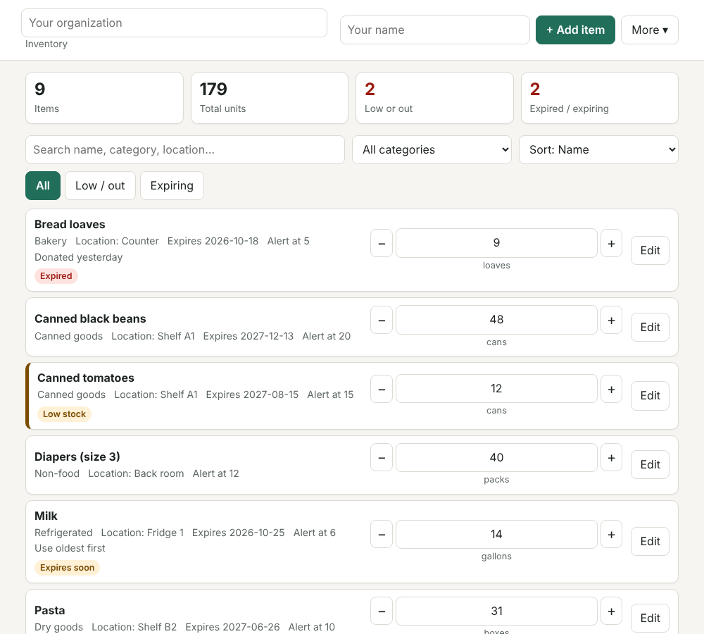

# Shelf

A lightweight inventory tracker for clubs, sports teams, and food pantries. It replaces the clipboard and the "who has the spreadsheet?" problem with a single page that works on a phone at the storage closet.



**No account, no server, no build step.** It is plain HTML, CSS, and JavaScript. Your data stays in your browser.

## Features

- **One-tap counts:** `+` / `−` buttons, or type a number to set stock directly
- **Low-stock alerts:** set an alert level per item; low and out-of-stock items are flagged
- **Expiry tracking:** "Expired" and "Expires soon" (within 14 days) badges, useful for food
- **Search, filter, sort:** by name, category, location, fewest first, or expiring soonest
- **History:** every change is logged with the time and the name of who made it (enter your name in the header)
- **Spreadsheet friendly:** export to CSV, or import a CSV from Excel or Google Sheets
- **Backups:** download everything as JSON and restore it on another device
- **Undo delete, print view, dark mode, keyboard accessible, works on phones**

## Run it

Open `index.html` in a browser. That's it.

Or serve it locally:

```bash
npm start        # python3 -m http.server 8000, then visit http://localhost:8000
```

## Put it on your own page (GitHub Pages)

1. Create a new GitHub repository and push these files to it.
2. In the repo, go to **Settings → Pages**.
3. Under **Build and deployment**, choose **Deploy from a branch**, select `main` and `/ (root)`, and save.
4. After a minute your site is live at `https://<your-username>.github.io/<repo-name>/`.

## Using it with a group

Data is stored per browser, so one device is the "source of truth":

- Pick one shared tablet or laptop for the pantry, or one person to keep the counts.
- To share with others, use **More → Download backup** and send the file, or **Export CSV** for a read-only copy.
- **More → Import** restores a backup (replaces everything) or merges a CSV (items with the same name and location are updated; others are added).

Clearing your browser's site data erases the inventory, so download a backup regularly.

## CSV format

The first row must be a header. Only `Name` is required; common alternatives such as `Item`, `Qty`, `Reorder at`, and `Expiry` are recognized.

```csv
Name,Category,Quantity,Unit,Low stock at,Location,Expires,Notes
Canned black beans,Canned goods,48,cans,20,Shelf A1,2027-12-13,
Milk,Refrigerated,14,gallons,6,Fridge 1,2026-10-25,Use oldest first
```

Dates use `YYYY-MM-DD`. Quantities are whole numbers.

## Project layout

```
index.html        page structure and dialogs
style.css         styling (light and dark, responsive, print)
core.js           inventory logic: filtering, sorting, alerts, CSV (no DOM, unit tested)
app.js            UI and localStorage
test/core.test.js unit tests (npm test, no dependencies)
```

## Tests

```bash
npm test
```

## Ideas for next steps

- Sync between devices with a small backend or a Google Sheet
- Barcode scanning with the browser's `BarcodeDetector` API
- Per-person check-out / check-in for team equipment
- Installable offline app (a service worker and manifest)

## License

MIT, see [LICENSE](LICENSE).
